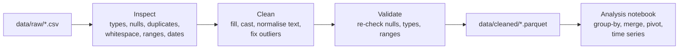
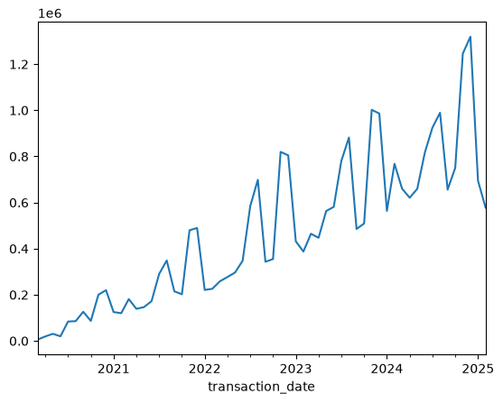

# Retail Data Cleaning and Analysis with pandas

Data cleaning, validation and exploratory analysis of three datasets with pandas: a retail **transactions** table (32,295 rows), a **customers** table (5,000 rows), and Arabic-language **used-device listings** from the Haraj marketplace (438 rows). Each dataset is inspected, cleaned, validated and saved as Parquet, and the retail data is then analysed with group-bys, merges, pivot tables and time-series methods.


## Problem Statement

Raw data is rarely ready for analysis: it has missing values, inconsistent text, wrong data types and outliers. This project applies a repeatable inspect → clean → validate → save routine to each dataset before answering business questions about sales, customers and seasonality.

## Objectives

- Profile each dataset: shape, data types, missing values, duplicates, whitespace, value ranges and invalid dates.
- Clean the data with documented, column-by-column decisions.
- Validate the result and store it in a typed, compact format (Parquet).
- Answer analysis questions with `groupby`, `merge`, `pivot_table`, `melt`, `map`, `query` and `resample`.

## Technologies

| Area | Tools |
|---|---|
| Language | Python 3.12 |
| Data processing | pandas, NumPy, PyArrow (Parquet) |
| Visualisation | matplotlib |
| Environment | uv, Jupyter (ipykernel) |

## Workflow



## Cleaning Steps

| Dataset | Main cleaning decisions |
|---|---|
| **Customers** | `age` to nullable integer, `zip_code` to string, `registration_date` to datetime; missing gender, city, state and channel set to `"Unknown"`; text columns trimmed and lower-cased; names title-cased; ages checked for impossible values. |
| **Transactions** | Missing product, category, store and payment fields set to `"Unknown"`; missing `quantity` filled with the median; missing `price` filled with the **median price of the same product**; low-cardinality columns converted to `category`; dates parsed. |
| **Used devices (Haraj)** | `tags` parsed from strings to lists, de-duplicated and stripped of `"empty"` placeholders; city and title normalised; an implausible price outlier set to missing; columns renamed to `snake_case`; `city` as `category`; dates parsed. Memory use is measured before and after. |

## Key Findings

From the outputs in [`01_core_analysis.ipynb`](notebook/analysis/01_core_analysis.ipynb):

- Transactions run from **March 2020 to February 2025** and grow every full year, from 1,030 in 2020 to 11,408 in 2024.
- **Online** is the largest channel, with 16,108 of 32,295 transactions; each physical store has about 1,500.
- **Credit card** is the most common payment method (10,907 transactions), followed by debit card and PayPal.
- Demand is seasonal: **November and December** are the busiest months, and Q4 has the most transactions.
- The busiest 7-day period (rolling average of about 58 transactions per day) ends on 1 December 2024.



## Project Structure

```text
retail-data-cleaning-analysis/
├── data/
│   ├── raw/                    # original CSV files (unchanged)
│   └── cleaned/                # Parquet output from the cleaning notebooks
├── notebook/
│   ├── cleaning/
│   │   ├── customers.ipynb
│   │   ├── transactions1.ipynb
│   │   └── usedDevices.ipynb
│   └── analysis/
│       └── 01_core_analysis.ipynb
├── reports/figures/            # charts exported from the analysis notebook
├── src/src/                    # short pandas and NumPy practice drills
├── pyproject.toml
└── uv.lock
```

## Installation

Requires [uv](https://docs.astral.sh/uv/). uv installs Python 3.12 automatically (pinned in `.python-version`).

```bash
git clone https://github.com/Re7absu/retail-data-cleaning-analysis.git
cd retail-data-cleaning-analysis
uv sync
```

## How to Run

Open the notebooks in VS Code (select the `.venv` kernel) or in Jupyter:

```bash
uv run --with jupyterlab jupyter lab
```

Run the cleaning notebooks first, then the analysis notebook:

1. `notebook/cleaning/customers.ipynb`
2. `notebook/cleaning/transactions1.ipynb`
3. `notebook/cleaning/usedDevices.ipynb`
4. `notebook/analysis/01_core_analysis.ipynb`

The cleaned Parquet files are already committed, so the analysis notebook can also be run on its own.

## Data Sources

- **Customers and transactions:** a US retail dataset with generated customer details. The original source is not recorded in this repository.
- **Used devices:** public listings from the Haraj marketplace (Saudi Arabia). The original source is not recorded in this repository.

Use of the data is for learning purposes only.

## Future Improvements

- Move the cleaning logic from the notebooks into reusable functions in `src/` with tests.
- Add a data dictionary for each cleaned dataset.
- Add analysis of the used-devices listings (prices by city, popular tags).
- Record the original data sources and their licences.

## License

The code and notebooks are released under the [MIT License](LICENSE). The datasets in `data/` are not covered by this license and keep their original terms (see [Data Sources](#data-sources)).
